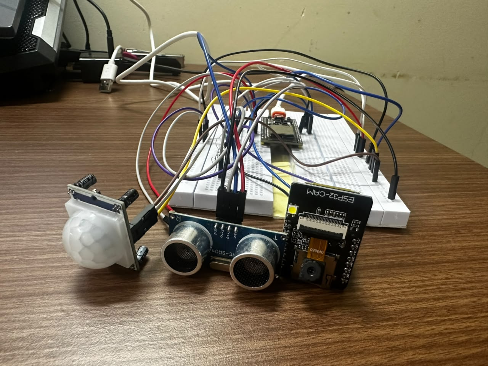
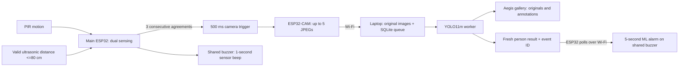
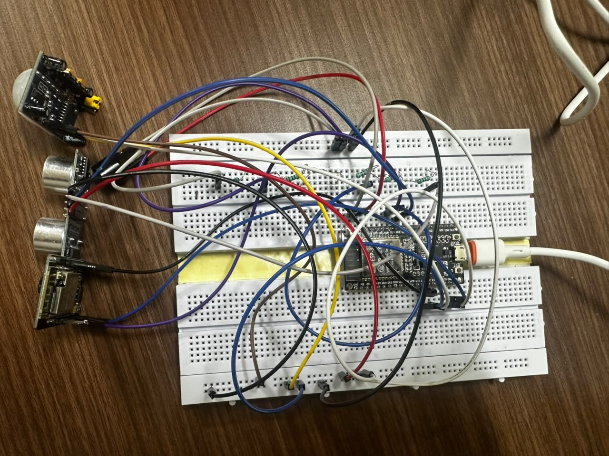

# Aegis

**Multilayer Smart Security System Using Sensor Fusion and ML Classification**

Aegis combines PIR motion and ultrasonic distance sensing with ESP32-CAM capture and laptop-based YOLO person detection. The main ESP32 coordinates camera triggering, two buzzer responses and automatic rearming. The prototype was validated in a laboratory and is reported as **TRL 4** in the final IDF-B report.



## Documents and demonstration

| Resource | Link |
|---|---|
| Final IDF-B report | [PDF](docs/reports/Aegis-IDF-B-Final.pdf) |
| Final presentation | [PDF](docs/reports/Aegis-Final-Presentation.pdf) |
| Literature review | [PDF](docs/reports/Literature-Review.pdf) |
| Project documents | [Google Drive folder](https://drive.google.com/drive/folders/1Rs7gQRz6L4jBZ60WNHvU_y9cqgrrzC3j) |
| Videos and photos | [Google Drive folder](https://drive.google.com/drive/folders/1HNvcwVTa0PmXekuO8vypJGZRFo8zPRFB) |
| Final demo video | [Watch on Drive](https://drive.google.com/file/d/1nkyFItA0RH52xe4BkIHqJ0sR-sAcOO-Q/view) |
| Circuit reference | [Velxio](https://velxio.dev/project/7663d523-7c50-4077-b14d-827a63104cb7) |

See [project resources](docs/project-resources.md) for references and differences between earlier proposals and the implemented system.

## How it works



1. While **ARMED**, PIR motion and a **valid distance ≤80 cm** must agree for three consecutive samples. Disagreement or an invalid echo resets the counter. Sampling is nominally every 250 ms, rather than a guaranteed fixed response time.
2. The main ESP32 sends a **500 ms wired trigger pulse** and requests a **1-second sensor beep**, independent of Wi-Fi. The camera captures and uploads up to five JPEGs.
3. The laptop preserves originals and queues each image for YOLO person detection. The dashboard groups bursts and displays original/annotated images, scores, person counts and processing state.
4. The main ESP32 polls for a **new eligible person result** nominally once per second. Both upload receipt and completed inference must be within the 90-second freshness window. A silent startup baseline and handled event IDs suppress old/repeated alarms.
5. A qualifying result requests a **5-second ML alarm**. This overrides the short beep; a later sensor request cannot shorten or restart an active ML alarm.
6. After the trigger pulse ends, **no PIR motion and valid distance >100 cm continuously for 2 seconds** return the sensor controller to ARMED. Rearming does not wait for ML processing or buzzer completion.

No-person, pending, failed, stale and imported legacy records add no ML alarm. A sensor beep is not proof that capture, upload or inference succeeded. Person detection does not establish identity, authorization, intent or liveness.

[Architecture and FSM](docs/architecture.md) · [Wiring](docs/wiring.md) · [ML alarm setup](docs/ml-buzzer.md)

## Hardware

| Signal | Connection |
|---|---|
| PIR OUT | Main ESP32 GPIO13 |
| HC-SR04 TRIG | Main ESP32 GPIO5 |
| HC-SR04 ECHO | Through a voltage divider to main GPIO18 |
| Camera trigger | Main GPIO19 → ESP32-CAM GPIO13 |
| Passive buzzer | Main GPIO23 and GND |
| Supply/reference | Regulated 5 V board supply and common ground |

Keep ESP32 GPIO within 3.3 V logic levels. Camera power must remain stable during capture and Wi-Fi upload. Confirm the board pin map and follow the [wiring guide](docs/wiring.md) before connecting hardware.



## Software and ML

- **Backend:** Python LAN receiver, SQLite queue, original-image storage, result and hardware-status APIs.
- **Worker:** one model instance, exclusive lock, heartbeat and recovery of interrupted processing jobs.
- **Dashboard:** React + Vite, burst review, original/annotated images, filtering and hardware monitoring.
- **Gallery-worker configuration:** local YOLO11m, person class only, confidence **0.35**, inference size **960**. Inference runs on the laptop.
- **Report camera settings:** OV3660, **800 × 600**, PSRAM, JPEG quality **12**, one frame buffer and nominal 250 ms inter-photo pause.
- **Box checks:** confidence ≥0.35, area ≥0.5% of image area, height ≥10% of image height and width/height ≤3.0. Dark-frame CLAHE, padding fallback and overlap filtering are supported; TTA is off by default.
- **Dataset tools:** manual person/empty labeling, reviewed-label export, session/duplicate-aware splitting, candidate training and comparison. Candidate scripts do not automatically deploy their output.

The standalone detector defaults to person_ft.pt at threshold 0.50; the gallery worker explicitly selects the configured model at 0.35. These are different configurations. The separate HQ camera candidate also differs from the report settings. See [ML usage](ml/README.md), [camera fine-tuning](docs/camera-finetuning.md) and [firmware source guide](firmware/README.md).

## Recorded results

These are **saved image-level evaluations of person_ft.pt at threshold 0.50**, not current YOLO11m accuracy or complete hardware-system performance.

| Evaluation | Images | TP / FN / FP / TN | Precision | Recall | False-positive rate |
|---|---:|---|---:|---:|---:|
| Historical | 227 | 137 / 7 / 2 / 81 | 98.56% | 95.14% | 2.41% (2/83) |
| Recovered | 218 | 129 / 7 / 2 / 80 | 98.47% | 94.85% | 2.44% (2/82) |

Training/test independence remains unverified. The final report records laboratory animal-motion and person-presence trials; those observations do not establish a statistical false-alarm rate. A detection confidence score is not overall accuracy or a confidence interval.

The presentation's **39.7%, 14.8% and 2.7%** configuration comparison is explicitly hypothetical teaching data. A matched PIR-only / dual-sensor / full-system experiment has not established that reduction.

[Evaluation details and formulas](docs/results.md)

## Setup on Windows

Use Python 3.10+ and a Node.js version compatible with frontend/package.json. Firmware requires Espressif Arduino board support and ArduinoJson.

From the repository root in PowerShell:

```powershell
py -m venv ml/.venv
.\ml\.venv\Scripts\python.exe -m pip install -r backend/requirements.txt -r ml/requirements.txt
New-Item -ItemType Directory -Force captures, ml/gallery_predictions, storage
Copy-Item backend/config.example.json backend/config.local.json
```

1. Obtain the YOLO11m checkpoint from the model publisher and place it at ml/yolo11m.pt, or configure another reviewed local checkpoint. Weights and private datasets are not bundled.
2. Edit backend/config.local.json with your paths, a camera token and a separate alarm token of at least 16 characters. Relative paths resolve from backend/.
3. Build the frontend:

```powershell
cd frontend
npm ci
npm run build
cd ..
```

4. Copy the relevant firmware config.example.h to config.h and enter your local Wi-Fi details, laptop LAN IP and matching tokens. A board's localhost does not point at the laptop.
5. Confirm the intended sketch, board pin map and upload settings before flashing. Source references are not a readback of the firmware currently on the boards. Keep config.h and config.local.json private.

### Daily start

1. Connect laptop and boards to the same reachable Wi-Fi.
2. Run START_ALL.bat, then CHECK_SYSTEM.bat.
3. Open **http://localhost:5000/** on the demo laptop. This is a local website, not a hosted public service.
4. Connect the hardware monitor to the main board's actual serial port at 115200 baud. Let the camera finish booting.
5. Trigger an event, check received frames and final ML states, then clear the zone and verify rearming. Missing frames remain failures rather than assumed completions.

START_DEV.bat runs Vite for frontend development. START_LABELING.bat opens the labeling tool. BACKUP_DATA.bat creates an ignored local evidence/database backup. See [startup and recovery](docs/startup.md).

## Repository map

```text
backend/       Receiver, queue, worker, serial integration and tests
frontend/      Aegis React dashboard
firmware/      Main ESP32 and camera sources/configuration templates
ml/            Detector, evaluation, labeling and training tools
scripts/       Launch, health-check, backup and optional GPU tools
docs/          Architecture, results, references, photos and final PDFs
```

Newer local source takes priority. Missing operational files retained from the existing repository are listed in [source recovery notes](docs/source-recovery.md). Local environments, captures, databases, weights and credentials are excluded from source synchronization.

## Research and future work

The final report draws on Pugh et al. (2015), Ciuffreda et al. (2023) and Patino et al. (2022). Sensor fusion and visual alarm verification are established approaches. Aegis documents a particular implementation rather than claiming the components alone are novel.

Next steps include matched configuration trials, independent scene evaluation, candidate-model comparison, improved lighting and fault handling, and a separate personnel-authorization layer. The project aligns with innovation in **SDG 9** and shared-space safety in **SDG 11**; broader safety and energy benefits have not been measured.

## Team

| Member | Registration number |
|---|---|
| Muhammed Sameer | 25BCE2703 |
| Aaron Robertson | 25BCE2640 |
| Ketan Mulani | 25BCE2634 |
| Abdul Hadi | 25BCE0553 |

**Course:** Embedded Systems Architecture (BACSE324) · **Slot:** E1+TE1 · **Faculty:** Dr Debashish Dash
