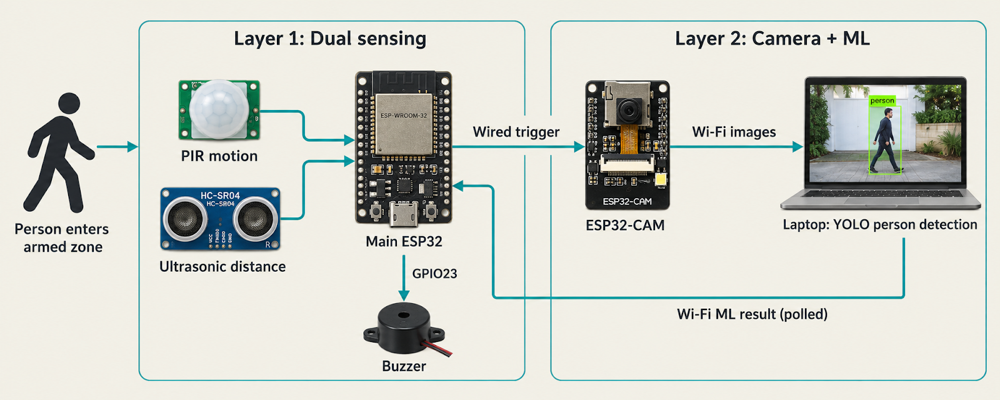
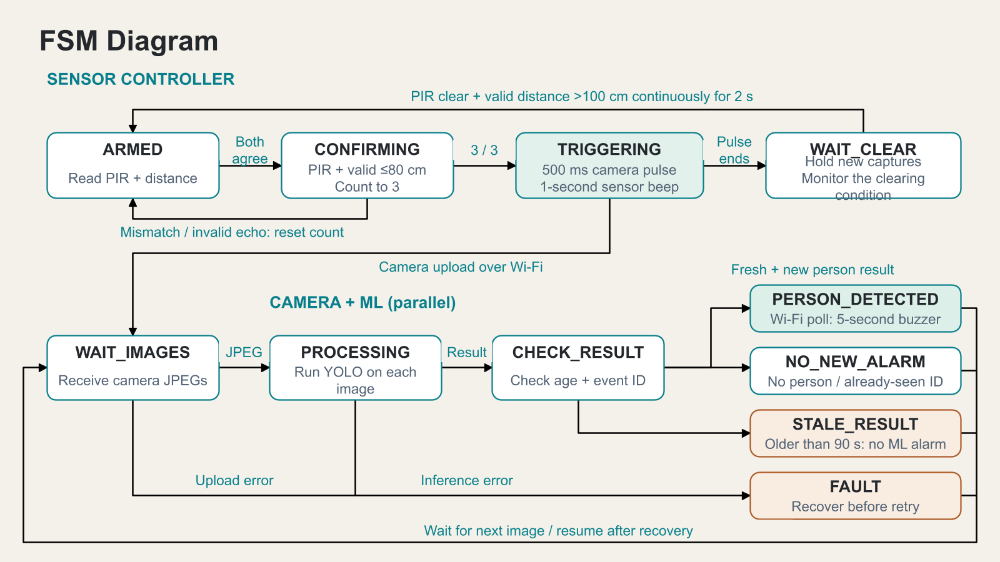

# Aegis architecture and control

*Original architecture illustration extracted from the final IDF-B report.*

## Two layers

PIR and ultrasonic sensors connect to the main ESP32. Three consecutive agreements request a wired ESP32-CAM trigger and short beep. The camera uploads images to a laptop, which preserves originals, queues SQLite jobs, runs YOLO and serves the Aegis dashboard. The main board polls for eligible person results and controls one shared buzzer. Neither ESP32 runs YOLO.

## Sensor decision table

| PIR | Ultrasonic | Agreement count | Action while armed |
|---|---|---|---|
| No motion | Valid >80 cm | Reset | Continue monitoring |
| Motion | Valid >80 cm | Reset | No automatic capture |
| No motion | Valid ≤80 cm | Reset | Nearby object alone does not trigger |
| Motion | Valid ≤80 cm | Increment | At 3: camera pulse + 1-second beep |
| Either | Invalid / no echo | Reset | No new automatic event |

For a valid echo, `d = c × t / 2`. With sound speed approximately 343 m/s, `d(cm) ≈ 0.0343 × t(µs) / 2`. Division by two accounts for outward and return travel.

At sample k, `A(k) = PIR(k) AND valid_echo(k) AND [distance(k) ≤ 80 cm]`. The counter increments on agreement and resets otherwise. Three matches are consecutive samples, not a guaranteed elapsed time: network activity can delay nominal 250 ms sampling.

## Finite State Machine

This conceptual diagram explains concurrent sensor and camera–ML processes; it is not a literal enumeration of every firmware variable. A trigger requests acquisition, rather than proving an image arrived.

- **ARMED / CONFIRMING:** read motion and distance; count matching samples.
- **TRIGGERING:** disarm automatic capture, pulse GPIO19 for 500 ms and request the short beep.
- **WAIT_CLEAR:** after the pulse, require PIR LOW and valid distance >100 cm continuously for 2 seconds. Failed clearance resets the timer.
- **WAIT_IMAGES / PROCESSING / CHECK_RESULT:** receive JPEGs, run queued inference and check result freshness and identity.
- **PERSON_DETECTED:** an eligible result requests the ML alarm; inference does not block for its duration.
- **NO_NEW_ALARM / STALE_RESULT:** no additional ML alarm.
- **FAULT:** failed upload or inference remains an error; resume after recovery or a new valid job.

The hysteresis gap is `100 − 80 = 20 cm`, separating trigger and clearance boundaries. Invalid echo means unknown distance, not clearance. Rearming does not wait for ML or buzzer completion.

## Alarm feedback

The first stage requests a 1-second beep independently of Wi-Fi. The main controller polls `/api/alarm/latest` nominally once per second using a separate alarm token. Both upload receipt and inference completion must be within 90 seconds. The first successful boot response establishes a silent baseline; handled event IDs suppress repeats.

A new eligible person result requests a 5-second ML alarm. ML timing overrides the short beep, and a later sensor beep cannot shorten or restart it. No-person, pending, failed, stale and imported legacy records add no ML alarm. Timer-controlled duration is not sensor-to-alarm latency.

## Capture and traceability

The final report describes 800 × 600 JPEGs, PSRAM, quality 12, one frame buffer and up to five frames per burst. Each upload waits for acknowledgment; retries preserve bytes and identifier. The separate HQ candidate uses different settings.

The receiver validates uploads and preserves originals. One worker loads the local model, publishes heartbeat, holds an exclusive lock and saves annotated JPEG/JSON. Interrupted processing can be requeued. Errors are not successful no-person results.

See [wiring](wiring.md), [firmware guide](../firmware/README.md) and [results](results.md).
